# WSL2 镜像网络与 TUN 冲突修复补丁 (wsl-mirrornetwork-patch)

[](https://learn.microsoft.com/zh-cn/windows/wsl/)
[](https://github.com/MetaCubeX/mihomo)
[](LICENSE)
[](https://naivezip.github.io/2026/10/12/wsl2-mirrored-tun-loopback-deadlock/)

解决 Windows 11 下 **WSL2 启用镜像网络（`networkingMode=mirrored`）** 与 **代理软件 TUN 模式（基于 Mihomo / Clash Meta，如 Clash Verge Rev、FlClash）** 共存时，因物理网卡 `Forwarding` 导致回路死锁、节点全部超时（Timeout）、全局网络瘫痪的问题。

> 📖 **详细技术排查长文**：[WSL2 镜像网络与 TUN 冲突排查：物理网卡 Forwarding 引发的回路死锁 · 莫愁前路无知己](https://naivezip.github.io/2026/10/12/wsl2-mirrored-tun-loopback-deadlock/)

---

## 📌 问题背景与症状

### 典型症状
* **仅开启系统代理（System Proxy）时**：Windows 与 WSL2 网络均正常。
* **一旦开启 TUN 模式**：
  * 代理客户端中所有节点测速瞬间全部变红并显示 `Timeout`；
  * 国内直连网站与服务（百度、B站等）无限加载或连接重置（ERR_CONNECTION_RESET）；
  * WSL2 与 Docker 容器网络同步断连；
  * 查看代理内核日志，会捕获到高频报错：
    ```json
    {"type":"warning","payload":"[TCP] dial DIRECT ... error: reject loopback connection to: ..."}
    ```

### 为什么常规方法无效？
很多用户误以为是“驱动损坏”、“节点失效”或“协议栈（gVisor / System）不兼容”。但无论重启代理软件、重装 Wintun 驱动还是重启电脑，一旦启动 WSL2 或 Docker Desktop，网络立即再次瘫痪。

---

## 🔍 原理分析与死锁因果链

```mermaid
flowchart TD
    subgraph ConflictLoop [" 死锁回路产生过程 "]
        A["WSL2 镜像网络启动<br/>(.wslconfig: networkingMode=mirrored)"] -->|HNS 过滤驱动| B["Windows HNS 强制将宿主机物理网卡<br/>IPv4 Forwarding 置为 Enabled (ActiveStore)"]
        C["代理客户端开启 TUN 模式"] -->|注入高优先级路由 0.0.0.0/1| D["系统默认网关流量被 TUN 接管"]
        E["DIRECT 直连流量 / DNS 解析"] -->|Mihomo 绑定物理网卡 IP 出站| F{"Windows TCP/IP 协议栈<br/>(tcpip.sys)"}
        B -.-> F
        F -->|"物理网卡开启转发 (Forwarding)<br/>发出的数据包被误判为转发流量"| G["数据包被路由回灌至 TUN 虚拟网卡 (Packet Re-entry)"]
        G --> H{"Mihomo 内核防回环检测"}
        H -->|"检测到出入站连接特征重合<br/>判定为网络回路 (Loopback)"| I["触发防死锁熔断:<br/>reject loopback connection"]
        I --> J["直连链路被截断 -> DNS 超时 -> 节点测速全部 Timeout -> 全局断网"]
    end

    subgraph Solution [" 补丁修复机制 "]
        K["WSL2 启动 Hook (/etc/wsl.conf)"] -->|触发| L["Windows 计划任务 (Session 0 静默执行)"]
        M["系统开机 (AtStartup) + 每小时轮询"] --> L
        L --> N["DisableEthernetForwarding.ps1"]
        N -->|"动态过滤虚拟网卡，仅将联网物理网卡<br/>Forwarding 重置为 Disabled"| O["直连流量正常由物理网关出站<br/>回路消除，TUN 与 WSL2 稳定共存"]
    end

    style ConflictLoop fill:#fff5f5,stroke:#feb2b2,stroke-width:1px
    style Solution fill:#f0fff4,stroke:#9ae6b4,stroke-width:1px
```



### 核心因果链条
1. **HNS 动态修改 ActiveStore**：WSL2 镜像网络挂载过滤驱动时，Windows Host Network Service (HNS) 会在**内存运行态（ActiveStore）**强行将出口物理网卡（以太网 / WLAN）的 IPv4 转发属性置为 `Forwarding: Enabled`。
2. **流量回灌 TUN 网卡**：开启 TUN 模式后，Mihomo 对于规则判定为 `DIRECT` 的出站流量，会直接将 Socket 绑定到物理网卡 IP。但因物理网卡 Forwarding 处于启用状态，Windows 协议栈将发出的包误判为待转发包，将其重新路由送入 TUN 虚拟网卡。
3. **Mihomo 触发防死锁熔断**：内核捕获到死循环数据包，为防止耗尽系统资源直接执行熔断（`reject loopback connection`），直连流量与 DNS 解析全面中断，引发雪崩式全局超时。
4. **ActiveStore 导致持久化失效**：每次重启 WSL2 或 Docker，HNS 都会在 ActiveStore 中重新置回 `Enabled`，因此单次手动修改或单纯修改注册表均无法根除。

---

## ✨ 解决方案特性

本项目提供无感、轻量且彻底的自动化解决方案：

- 🚀 **完全静默无感知**：通过 Windows 任务计划程序在后台 `NT AUTHORITY\SYSTEM` 账户（Session 0）下静默运行，启动 WSL 或 Docker 时**绝不弹出任何 PowerShell 黑框抢焦点**。
- ⚡ **启动即时生效**：通过 WSL2 的 `/etc/wsl.conf` 启动 Hook，WSL 启动的瞬间立即调用宿主机计划任务，抹平 HNS 带来的状态污染。
- 🛡️ **智能网卡过滤**：严格过滤虚拟适配器（`vEthernet`、`Loopback`、`Mihomo`、`Clash`、`Tailscale`、`ZeroTier`、`VMware`、`VirtualBox`、`Radmin`、`utun` 等），仅针对当前已连接的真实物理网卡操作。
- 🔄 **双态持久化防护**：同时重置 `ActiveStore`（内存态）与 `PersistentStore`（持久态），防范网络切换与接口重新初始化。
- 📦 **开箱即用**：提供一键安装与卸载脚本，自动检测 WSL 分发版并注入配置。

---

## 🚀 快速开始

### 方式一：PowerShell 一键在线安装（推荐）

以管理员身份打开 PowerShell，执行以下一行命令即可完成安装并立即修复网络：

```powershell
irm https://raw.githubusercontent.com/naivezip/wsl-mirrornetwork-patch/main/install.ps1 | iex
```

---

### 方式二：克隆或下载仓库安装

1. 克隆或下载本项目至本地：
   ```powershell
   git clone https://github.com/naivezip/wsl-mirrornetwork-patch.git
   cd wsl-mirrornetwork-patch
   ```
2. 右键 `install.bat` 选择 **“以管理员身份运行”**（或在管理员 PowerShell 中执行 `.\install.ps1`）。
3. 安装程序会自动：
   - 部署核心脚本至 `C:\ProgramData\DisableEthernetForwarding.ps1`；
   - 注册后台静默计划任务 `DisableEthernetForwarding`；
   - 检测已安装的 WSL 分发版，并提示自动写入 `/etc/wsl.conf` 启动 Hook；
   - 立即执行一次网络修复，无需重启系统。

---

## 🛠️ 手动配置说明（可选）

如果您更喜欢手动管理系统配置，请按以下步骤操作：

### 1. 部署 Windows 计划任务与脚本
以管理员身份运行 PowerShell：
```powershell
# 1. 编写动态禁用转发脚本
$scriptContent = @'
try {
    $excludePattern = 'vEthernet|Loopback|Mihomo|Clash|Sing-box|Tailscale|ZeroTier|VMware|VirtualBox|Radmin|utun|wintun|tap|wireguard|docker|container'
    $interfaces = Get-NetIPInterface -AddressFamily IPv4 -ErrorAction SilentlyContinue | Where-Object {
        $_.ConnectionState -eq 'Connected' -and
        $_.Forwarding -eq 'Enabled' -and
        $_.InterfaceAlias -notmatch $excludePattern
    }
    foreach ($if in $interfaces) {
        Set-NetIPInterface -InterfaceIndex $if.InterfaceIndex -AddressFamily IPv4 -Forwarding Disabled -PolicyStore ActiveStore -ErrorAction SilentlyContinue
        Set-NetIPInterface -InterfaceIndex $if.InterfaceIndex -AddressFamily IPv4 -Forwarding Disabled -PolicyStore PersistentStore -ErrorAction SilentlyContinue
    }
} catch {}
'@
Set-Content -Path "C:\ProgramData\DisableEthernetForwarding.ps1" -Value $scriptContent -Encoding UTF8 -Force

# 2. 注册 SYSTEM 后台计划任务（静默无弹窗）
$action = New-ScheduledTaskAction -Execute "powershell.exe" -Argument "-NoProfile -WindowStyle Hidden -ExecutionPolicy Bypass -File `"C:\ProgramData\DisableEthernetForwarding.ps1`""
$triggerStartup = New-ScheduledTaskTrigger -AtStartup
$triggerStartup.Delay = "PT15S"
$triggerHourly = New-ScheduledTaskTrigger -Once -At (Get-Date) -RepetitionInterval (New-TimeSpan -Hours 1) -RepetitionDuration (New-TimeSpan -Days 3650)
$principal = New-ScheduledTaskPrincipal -UserId "NT AUTHORITY\SYSTEM" -LogonType ServiceAccount -RunLevel Highest
$settings = New-ScheduledTaskSettingsSet -AllowStartIfOnBatteries -DontStopIfGoingOnBatteries -StartWhenAvailable -MultipleInstances IgnoreNew
Register-ScheduledTask -TaskName "DisableEthernetForwarding" -Action $action -Trigger @($triggerStartup, $triggerHourly) -Principal $principal -Settings $settings -Force | Out-Null

# 3. 立即运行一次
& "C:\ProgramData\DisableEthernetForwarding.ps1"
```

### 2. 配置 WSL 启动 Hook
进入您的 WSL2 终端（如 Ubuntu），编辑 `/etc/wsl.conf`：
```bash
sudo nano /etc/wsl.conf
```
添加或合并以下 `[boot]` 节：
```ini
[boot]
systemd=true
command="/mnt/c/Windows/System32/schtasks.exe /run /tn DisableEthernetForwarding"
```
保存退出后，在 Windows PowerShell 中执行 `wsl --shutdown` 重启 WSL 生效。

---

## 🧪 验证方法

### 1. 检查物理网卡转发状态
在 Windows 终端中查看当前联网物理网卡（如“以太网”或“WLAN”）：
```powershell
netsh interface ipv4 show interface "以太网"
```
输出中应显示：
```text
Forwarding : disabled
```
如果为 `disabled`，即代表处于正常状态。

### 2. 直连请求验证
开启 TUN 模式后，发起一次直连测试：
```powershell
curl.exe -m 8 -v --noproxy "*" "http://www.baidu.com"
```
如果能够立即获取 HTTP 响应，且代理客户端日志不再出现 `reject loopback connection`，则说明补丁已完美工作。

---

## 🗑️ 卸载方法

若需移除补丁，右键 `uninstall.bat` 选择 **“以管理员身份运行”**（或在管理员 PowerShell 中执行 `.\uninstall.ps1`）。

该操作将注销计划任务 `DisableEthernetForwarding` 并清理 `C:\ProgramData\DisableEthernetForwarding.ps1` 脚本。

---

## 🔗 相关 Issue 与参考资料

- 博客原文章：[WSL2 镜像网络与 TUN 冲突排查：物理网卡 Forwarding 引发的回路死锁 · 莫愁前路无知己](https://naivezip.github.io/2026/10/12/wsl2-mirrored-tun-loopback-deadlock/)
- [MetaCubeX/mihomo#3186 - Windows 物理网卡开启 Forwarding 导致 TUN 回环](https://github.com/MetaCubeX/mihomo/issues/3186)
- [MetaCubeX/mihomo#3229 - 针对 WSL 镜像网络动态启用 Forwarding 的处理提案](https://github.com/MetaCubeX/mihomo/issues/3229)
- [microsoft/WSL#41652 - WSL mirrored network causes host network loopback](https://github.com/microsoft/WSL/issues/41652)

---

## 📄 开源许可证

本项目基于 [MIT License](LICENSE) 开源。
